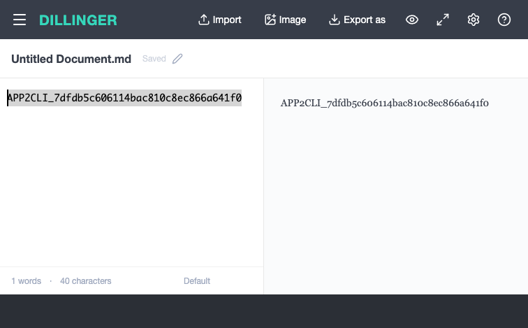

# Agent with REA

**Turn application knowledge into verifiable CLIs for agents.**

`app2cli` uses [REA](https://github.com/morluto/rea) to inspect an application, runs a coding agent to generate a semantic adapter, compiles it into a separate CLI package, and tests it against the actual app. Failures feed a bounded repair loop. Each generated CLI exposes typed commands, JSON output, request deduplication, version checks, and execution evidence.

[中文说明](README.zh-CN.md) · [Automatic generation](docs/generation.md) · [Adapter contract](docs/adapter-contract.md) · [Architecture and scope](docs/architecture.md)

```text
URL / APK → REA evidence → agent → adapter → CLI → real-app test + independent read
                            ↑                           │
                            └──── failure feedback ─────┘
```

The generator does not look up an application in the bundled adapter list. It tests reversible value/content replacement and Android navigation journeys with independent native predicates. These bounded tests do not cover every capability of an arbitrary app. An application may require login, lack accessible source/UI, or have no supported reversible operation; those cases fail explicitly. Analysis candidates and successful builds alone are not execution proof.

## API-first generation

Generation now defaults to refusing implicit UI fallback. A captured HAR plus an owned-resource API case enables REA-grounded **direct HTTP** generation and fresh, independent server GET verification. Credentials are environment bindings, not generated source. Existing browser-function and Android UI examples require `--allow-ui-fallback`. A separately reviewed read-only Douyin client API bridge reuses the browser's original authentication/signing chain and verifies actual network responses. It is not browser-independent HTTP or automatic APK API recovery. The final Restful Booker public-backend generation run passed 8/8 checks on its first candidate, including actual PATCH, independent GET and restoration. Prior authoring timeouts and a shared-backend reset failure are retained separately. See [API-first implementation and limitations](docs/api-first.md), [acceptance](docs/api-first-acceptance.json) and the [unchanged generated contract](examples/booker-api-generated/README.md).

## What works today

| Example | Execution | Verification | Generated command |
| --- | --- | --- | --- |
| Knockout TodoMVC | Original browser view-model functions | Model + DOM + localStorage + reload | `todomvc-cli todos create --title "Hello"` |
| Fossify Calculator 1.4.0 | Original Android UI controls via ADB | Two fresh native UI hierarchy observations | `fossify-calculator-cli calculate --a 12 --operator multiply --b 7` |
| Dillinger, generated from its live URL | Original native document-store actions, discovered by the agent | Independent preview observation after reload, plus original-content restoration | `dillinger-cli document replace --body "Hello"` |
| Editor 1.98, generated from its APK | Original Android text control and mode transitions, discovered by the agent | Independent UI hierarchy, original-text restoration, and a repeated scenario after app restart | `editor-cli buffer replace --text "Hello"` |

The recorded local run passed **13/13 real-app checks** and **10/10 kernel/compiler tests**. The framework and both generated tarballs also passed an isolated installation/readback check outside the repository, with no REA dependency in the generated runtime. See [package verification](docs/packaging-check.json).

The original Web and Android examples have been exercised on real applications. The Android example reads `84` from the installed app; it does not return a locally calculated answer. Local arithmetic is only a postcondition used to check the app's output. Android UI readback does not claim backend confirmation or persistence across process restarts.

The later automatic-generation experiment used **Dillinger without a pre-existing adapter**. After framework development fixes, a fresh URL-to-CLI run passed **8/8 real-app checks on its first candidate**, followed by another 8/8 recheck. A deliberately lying no-op adapter was rejected by the independent observer. The generated tarball also ran outside this repository without REA installed. That experiment used 22 fixture tests; the expanded suite can be run with `pnpm test`. See [generation acceptance](docs/generation-acceptance.json), including earlier failures and evidence boundaries, and the [unmodified generated example](examples/dillinger-generated/README.md).



The unseen Android target is **Editor 1.98**, supplied directly as an APK. A fresh generation run made three REA source probes and produced an unchanged agent-authored candidate that passed **8/8 native checks**. A repeated scenario after restarting the app also passed **8/8**. See the [APK walkthrough](docs/android-generation.md), [Android acceptance record](docs/android-generation-acceptance.json), and [generated source](examples/editor-generated/README.md). These checks establish native buffer contents and mode restoration, not saved-file or backend persistence. Earlier failed candidates and the single parent-side recovery are disclosed separately. A lying no-op copy was independently rejected. The generated tarball was installed outside the repository without REA or Codex dependencies, then read, wrote a different text value, passed native readback and restored the original buffer.

The **Douyin Android 32.2.6** experiment starts from the official-page APK and extends a generated navigation adapter into ten commands. The final logged-out browsing/search journey passed **23/23 native checks**, including Chinese query submission and actual result captions. One incorrect test predicate caused by a reused native resource ID required explicit reviewer correction; the original failure and revised oracle are retained. This is not fully unattended or whole-app acceptance. See the [experiment](docs/douyin-android.md), [sanitized evidence summary](docs/douyin-android-acceptance.json), and [unchanged generated source](examples/douyin-generated/README.md).

## Install from this repository

Requirements: Node.js **24.11+**, pnpm, Chrome for the Web example. Android additionally needs an authorized ADB device/emulator and a full JDK 17+ for the pinned JADX analysis provider.

```bash
git clone https://github.com/qiuqionglin/Agent-with-rea.git
cd Agent-with-rea
pnpm install --frozen-lockfile --ignore-scripts
node bin/app2cli.mjs --help
node bin/app2cli.mjs list
```

REA is pinned to `6.7.0`. Set `REA_CLI_PATH` to its `scripts/rea.mjs` if it is installed elsewhere. No global agent configuration is modified. Downloaded applications, browser profiles, raw evidence and execution journals belong under ignored `.local/` directories.

## Generate from a new URL or APK

With an authenticated Codex CLI and Chrome installed:

```bash
node bin/app2cli.mjs generate https://dillinger.io/ \
  --allow-ui-fallback --id dillinger --out .local/generate/dillinger \
  --goal "Read and replace the current Markdown document; verify the preview after reload"
```

For Android, prepare REA's JADX provider and an authorized test device:

```bash
node bin/app2cli.mjs generate /path/to/application.apk \
  --allow-ui-fallback --id my-app --serial emulator-5554 --install --out .local/generate/android
```

The agent gets actual REA evidence, source files, a live UI observation and the adapter contract. It returns a candidate or requests another read-only probe. The runner compiles and executes the CLI, checks a separate native witness, and supplies real failures for repair. Web tests use a random marker that repair attempts cannot change. Failed restoration stops further mutations.

Success returns the package path, required local environment and digest-bound test report. Read its `--schema` for the generated command names. Run `app2cli verify <run-dir> --out <new-report-dir>` to repeat acceptance without another model call. [Generation details](docs/generation.md) cover options, limitations, source-integrity handling and private artifacts.

## Web: inspect, build, run

Start the unmodified, commit-pinned TodoMVC example in terminal 1:

```bash
pnpm demo:web
```

This serves the original application at `http://127.0.0.1:4317` and starts a dedicated Chrome profile with CDP at port `9377`. `CHROME_PATH` can select an installed Chrome executable; `HEADED=1` shows the window.

In terminal 2:

```bash
export APP2CLI_CDP=http://127.0.0.1:9377
export APP2CLI_HOME="$PWD/.local/state"

node bin/app2cli.mjs inspect web "$APP2CLI_CDP" --out .local/evidence/web
node bin/app2cli.mjs build adapters/todomvc \
  --evidence .local/evidence/web --out dist/todomvc

node dist/todomvc/cli.mjs --schema
node dist/todomvc/cli.mjs todos create --title "Hello from an agent" --request-id task-001
node dist/todomvc/cli.mjs todos list
```

`inspect` requires `--target <CDP target ID>` when more than one page is present. Choose the exact page rather than an arbitrary tab. Build outputs must be new directories. Each output is a normal npm package with its own executable:

```bash
cd dist/todomvc
npm install --ignore-scripts
npm link
todomvc-cli todos list
```

## Android: inspect the APK, then use the native app

1. Install a full JDK and Android platform-tools. Start a test emulator or authorize a test device. `adb devices` must show the selected device as `device`.
2. Download the pinned APK and JADX provider. The helper verifies SHA-256 and does not install anything globally:

```bash
node scripts/fetch-android.mjs
export REA_JADX_MCP_JAR="$PWD/.local/android/jadx.jar"
# JAVA_HOME must point to your full JDK, including jdk.compiler.
export APP2CLI_ANDROID_SERIAL=emulator-5554  # use your actual adb devices serial
export APP2CLI_HOME="$PWD/.local/state"
# Set REA_ADB_PATH to an absolute adb executable if it is not on PATH.

adb -s "$APP2CLI_ANDROID_SERIAL" install .local/android/calculator.apk
node bin/app2cli.mjs inspect android .local/android/calculator.apk \
  --class org.fossify.math.activities.MainActivity --method onCreate \
  --out .local/evidence/android
node bin/app2cli.mjs build adapters/fossify-calculator \
  --evidence .local/evidence/android --out dist/fossify-calculator

node dist/fossify-calculator/cli.mjs display
node dist/fossify-calculator/cli.mjs calculate \
  --a 12 --operator multiply --b 7 --request-id calc-001
```

The driver checks the installed APK hash, launches an exported activity, finds controls by resource ID, and derives coordinates from the current hierarchy. No root, Frida injection, or fixed screen coordinates are needed for this sample. Four arithmetic operators and bounded nonnegative integer operands are supported; it is not the entire Calculator feature set.

## Manual adapter authoring

```bash
node bin/app2cli.mjs scaffold --id my-app \
  --evidence .local/evidence/web --out adapters/my-app
```

The draft contains a candidate summary, a manifest and a deliberately non-executable adapter. An agent must implement the [adapter contract](docs/adapter-contract.md), map actual operations, add concrete version/evidence claims, and define independently checkable postconditions. Remove `config.draft` only after that work. Then build against the original REA evidence and run a bounded acceptance scenario.

Generated packages contain the authored adapter and small shared runtime. They do not contain raw capture data, user profiles, cookies, device serials, APKs, or a background REA server. REA is needed for analysis/build evidence, not for executing a compiled capability.

## Agent command contract

- Standard output is JSON. Progress goes to standard error. Failures set a nonzero exit status.
- `--schema` / `--help` describe capabilities without connecting to the app.
- Named flags are typed from JSON Schema; `--input '{...}'` supports structured input.
- Reuse `--request-id` for the exact same mutation retry. A dispatched operation without a verified outcome is not automatically repeated.
- Supply `--expected-revision` from an earlier read to reject stale state. `--dry-run` reads and plans without dispatching.
- A successful mutation includes its actual verification level and a private audit path.

Example result, abbreviated:

```json
{"ok":true,"app":"fossify-calculator","command":"calculate","data":{"result":"84","formula":"12×7"},"verification":{"level":"native-ui-readback","stages":["dispatched","readback_verified","fresh_readback_verified"]}}
```

See [llms.txt](llms.txt) for the compact agent guide.

## Tests and limits

```bash
pnpm test                # fixture-based kernel and compiler tests
pnpm test:live           # real Web + Android, after both analyses and sessions are ready
pnpm pack --pack-destination .local/packages
pnpm check:release --tarball .local/packages/agent-with-rea-0.1.0.tgz
```

CI runs unit and package checks. It does not pretend to run a signed-in browser or an Android device. The published [acceptance summary](docs/acceptance.json) records the separate local live run.

Current limits include a reversible-value generation test contract, model-dependent semantic mappings, local process locks, no automatic login renewal, no Android internal-method/Frida driver, and no iOS/desktop runtime driver. A source or APK change fails closed and requires reanalysis. Evidence substring checks validate recipe anchors, not a formal proof that the adapter correctly implements a business operation; real readback tests remain necessary.

## Related projects and license

[OpenCLI](https://github.com/jackwener/OpenCLI) provides browser primitives and site adapters. [CLI-Anything](https://github.com/HKUDS/CLI-Anything) generates application harnesses. This project explores a REA evidence-to-adapter workflow shared across Web and Android, with explicit execution verification. It does not claim that the broader application-to-CLI idea is new.

Project-authored code is MIT licensed. REA, runtime dependencies and example applications retain their own licenses. No third-party application binary or decompiled source is shipped. See [THIRD_PARTY_NOTICES.md](THIRD_PARTY_NOTICES.md).
