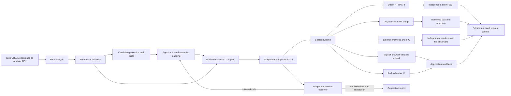

# Architecture and evidence boundaries

Agent with REA separates application analysis from application execution. This page describes the implemented prototype. The [product goal and target pipeline](product-goal.md) extend it to automatic capability discovery, application-wide CLI contracts and desktop interfaces; complete coverage must not be inferred from the current drivers. The bounded [application workflow](cases/application-generation.md) now supplies source/network discovery, multi-command generation, and a tested macOS Electron bridge.



## Repository layout

This is one npm package with four source responsibilities:

```text
bin/app2cli.mjs       executable bootstrap
src/cli.mjs          framework command routing
src/generator/       discovery, REA, agent prompts, generation/repair and builds
src/runtime/         per-application CLI, execution, manifests and locks
src/drivers/         HTTP, Web, Electron and Android interaction
src/verify/          independent observers and scenario runners
src/sdk.mjs          stable adapter helpers
src/utils.mjs        shared errors, hashing, JSON and bounded subprocess utilities
schemas/             adapter JSON Schema
examples/            curated and generated adapters, with their provenance
test/               framework and packaging tests
test/live/          real-application acceptance and negative controls
docs/cases/         public case reports and sanitized evidence summaries
lib/                 compatibility exports for previously generated adapters
.local/              ignored raw evidence, sessions, journals and build output
```

Runtime code and drivers do not depend on the generator or verification engine. Verification uses drivers, but never imports a generated adapter to establish its independent witness. The generator coordinates these components and feeds actual failures back to the agent. Application and reversible-resource workflows retain their distinct test contracts while sharing agent invocation, prompts, drivers, evidence handling and packaging.

The compiler parses ESM imports without evaluating the adapter, follows the runtime dependency closure, and copies only the required modules, resources and npm dependencies. HTTP CLIs carry no browser/Android driver, REA analysis, prompts or repair loop. The Android Python helper and the runtime schema are explicit resources. Computed adapter imports and imports of generator/verification internals fail packaging rather than creating an incomplete CLI.

New adapters use package imports such as `#app2cli/sdk`, `#app2cli/http-resource` and `#app2cli/application`. Builds retain the used mappings in their own package manifest. Eight `lib/*.mjs` compatibility exports support the imports in accepted historical adapters; their source bytes and digests stay unchanged. The framework CLI recognizes former example directory names when those paths do not exist.

The [refactor regression record](cases/refactor-acceptance.json) separates framework tests, real-application rechecks, installation outside this repository and environment recovery. It records the original and moved adapter hashes; it is a regression summary, not a new model-generation run.

## What each artifact proves

| Artifact | Producer | Meaning |
| --- | --- | --- |
| REA `*.json` stdout | REA 6.7.0 | Observations returned by the actual analysis provider, including its limitations |
| `evidence.json` | This framework | File/hash index of those outputs |
| `candidates.json` | This framework | Analysis projections for an agent; not runnable capabilities |
| `adapter.json` / `adapter.mjs` | Adapter author or coding agent | Claimed business mapping, target version and postconditions |
| `provenance.json` | Compiler | Claims were found in the selected analysis; `runtimeVerified` remains false |
| Execution audit | Runtime | Before / dispatch / after / fresh readback and errors |
| Acceptance summary | Test runner | Which scenarios actually passed in that run |
| `agent.stdout` / `agent.stderr` | Codex CLI | Native generation trace, retained privately |
| `generation.json` | Orchestrator | Attempt history and links to actual test failures; not a model-native trajectory |

The compiler checks raw-output digests and recipe anchors. It is not a semantic proof engine or a defense against a deliberately malicious local author. Adapter modules execute trusted local JavaScript. A REA finding can be incomplete; no generated wrapper can recover permissions, unavailable backend state, or unknown behavior merely by having a CLI name.

## Reusable kernel

`src/runtime/execute.mjs` has no website IDs, Android package IDs, business commands or hard-coded account data. It validates schema, identifies the execution surface, locks it across processes, checks the app version, reads state, computes a revision, reserves mutation request IDs, dispatches, verifies and writes a journal.

The lock is per execution surface rather than per adapter. Two adapters operating one Android device therefore share a lock. Journals are scoped by application and observed principal/session. Audit paths include the scope hash so reused request IDs in different accounts do not overwrite each other.

An outcome reserved before dispatch but not verified stays uncertain. It cannot be silently retried, even after a process restart. Verified replays return the historical result; use a separate read when current state is needed. Local journals and locks do not provide distributed exactly-once semantics. A crashed owner may leave a lock; inspect its `owner.json` before removing a confirmed stale directory.

## Drivers and current scope

| Channel | Status | Practical meaning |
| --- | --- | --- |
| Browser native functions | Implemented and tested | Invoke existing application functions through a selected CDP page |
| Android UI | Implemented and tested | Version-pinned APK, exported launcher, native resource-ID actions and UI readback |
| Direct HTTP API | Implemented | Observed HAR + owned-resource contract; auth environment binding, schema checks, direct requests, independent GET |
| Signed-in Web backend | Read-only Douyin bridge and Linkding lifecycle example implemented | Original browser session/request chain, source pins and independent network/server evidence; still needs browser |
| Android internal methods / Frida | Planned | Requires a separate runtime driver, method mapping and real acceptance evidence |
| Electron desktop | macOS driver and MarkText example accepted | Actual editor/IPC calls, renderer and file readback; application and workspace retained |
| Other desktop runtimes, iOS | Planned | These execution transports are not implemented |

REA supports more analysis targets than this repository currently supports for execution. Analysis coverage and operational coverage must be reported separately.

## Generation loop

A plain URL or `.app` selects the application workflow: source/network discovery, structured agent probes, multi-command adapter, independent lifecycle tests and failure feedback. Its observers reuse the owned session without importing adapter code. `discovery.json` consolidates current-run probes; capability declarations stay separate from accepted scenarios. Details and development interventions are in [application generation](cases/application-generation.md).

`generate` accepts a URL or APK without selecting a bundled adapter. REA analysis and independent DOM/UI observations provide the input. Codex returns a structured candidate or requests a bounded read-only probe. The framework validates, compiles and tests it in separate processes. Failures are fed back into a new attempt, with the original objective frozen. A failed restoration halts mutation attempts. See [automatic generation](usage.md) for the current reversible-value scope and evidence limitations.

## Operational findings

- TodoMVC's storage update is delayed. The runtime waits for model, DOM and storage to agree, then reloads.
- Android's launcher can recreate Calculator state. The driver checks the resumed activity and reuses an already foreground application, preserving read/replay behavior.
- Android calculation confirmation uses a second fresh UI hierarchy, not app restart. It reports `native-ui-readback` accordingly.
- This machine's REA native helper needed a macOS SDK matching its Swift compiler. An optional per-process `SDKROOT` solved it locally; no SDK path is hard-coded in the project.

## Relationship to existing projects

[OpenCLI](https://github.com/jackwener/OpenCLI) exposes browser primitives and site adapters, including an adapter-author workflow. [CLI-Anything](https://github.com/HKUDS/CLI-Anything) generates application CLI harnesses and describes source availability as a quality constraint. This project combines [REA](https://github.com/morluto/rea)'s analysis evidence with a small cross-platform adapter contract, independent CLI packaging and explicit result verification. These are design choices, not a claim that application CLIs are a new category.
