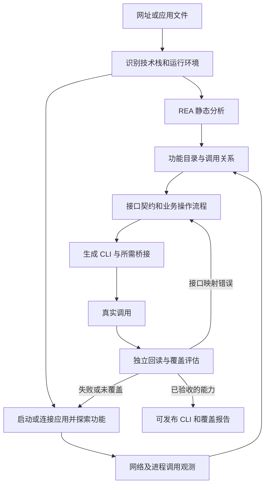

# 产品目标：从应用自动生成完整操作 CLI

本文件描述产品目标、验收定义和待实现路线。它不把规划中的发现器、桌面执行器或应用完整覆盖声明为已实现。当前可运行范围见 [API 实现](api-first.md) 和 [已有架构](architecture.md)。

## 用户交付什么，系统交付什么

用户给出一个网站地址、已安装桌面应用的位置或安装包、Android APK。系统自行识别技术栈，使用 REA 分析，探索可达功能，发现并验证接口，生成可安装的 CLI，测试失败后继续分析和修复。

正常流程不应要求用户先懂接口、手工抓 HAR、编写适配器或指定某个测试字段。现有 `--capture` / `--api-case` 是当前实现的高级输入与诊断入口；自动发现流程尚未接上，不能把这些输入当成最终产品门槛。

用户保留登录和必要的系统授权。系统产物应包括：

- 可独立安装、提供业务命令和结构化结果的应用 CLI；适用时提供维持原客户端会话的本地桥接进程。
- 应用功能目录、每项功能的调用契约和运行依赖。
- 原始分析证据、实际测试结果、覆盖情况、未解决项及版本指纹。

对外的目标是“让 Agent 通过 CLI 操作应用”。自动抓请求只是其中一个步骤。

## API 的范围

这里的接口是应用能力的程序入口，包含远端接口和本地接口。

| 应用或接口形态 | 需要发现的入口 | 执行方式目标 |
| --- | --- | --- |
| Web | HTTP、GraphQL、WebSocket、客户端请求封装和调用链 | 可重放请求直接调用；需要客户端会话时复用原请求链 |
| Electron 桌面应用 | JavaScript / ASAR、preload 暴露方法、IPC 通道、主进程处理函数、本地服务和远端接口 | 通过已验证的桥接入口调用，并保留原应用的状态管理 |
| 原生 / .NET 桌面应用 | 导出接口、命令或插件接口、RPC / IPC、可验证的内部方法及其调用约定 | 按技术栈提供执行桥接；反编译出的函数名本身不代表可调用 |
| Android | 网络请求层、客户端方法、组件边界及对应会话状态 | 可重放请求或原客户端调用桥接；现有 UI 驱动保留为显式回退 |

REA 是分析工具提供者；本项目仍要实现发现调度、语义映射、执行桥接和验证。REA 可分析某种格式，不等于本项目已经支持执行该格式中的功能。[REA 官方说明](https://github.com/morluto/rea)覆盖 JavaScript/Electron、原生二进制和 .NET 等分析对象；Electron 的 UI 与主进程通过 IPC 交互，因此完整功能发现不能只扫描网络 URL。[Electron IPC 文档](https://www.electronjs.org/docs/latest/tutorial/ipc)

## 目标流水线

1. **自动发现。** 源码或反编译结果提供候选入口；运行观测确认实际参数、响应和状态。探索需要触发懒加载模块、分页和不同页面路径。默认从读取和导航开始；不能因为目标是发现所有能力，就自动发送消息、付款或发布内容。
2. **统一建模。** 将 UI 功能、客户端方法、网络请求或 IPC、结果对象连接起来。剔除与用户功能无关的遥测请求，保留鉴权、上传、轮询等流程依赖。一个功能可能需要多个接口，一个接口也可能服务多个功能。
3. **恢复调用契约。** 每个操作记录参数和返回结构、会话要求、前置状态、依赖步骤、分页、异步完成条件、错误处理、副作用、版本约束以及独立验证方法。不能只有“URL + HTTP 方法”。
4. **编译业务 CLI。** 命令表达搜索、创建、编辑、导出等应用功能；底层选择 HTTP、原客户端请求模块、IPC 或本地方法。通用运行时承担重复工作，Agent 负责证据支持的应用语义。现有 `resource.read/set` 只是运行时实验，不能成为所有应用的最终命令模型。
5. **执行、验证、修复。** 将真实错误交给分析与生成循环；失败可能来自接口映射、会话、前置流程、版本变化或运行环境，不能只修改预期结果来通过。写操作需要独立回读；异步任务应核对最终产物，桌面文件操作应核对实际文件及应用状态。

生成阶段可以使用 UI 探索和触发请求。正常执行应优先走已验证的程序接口。界面回退必须在功能目录中单独标识，不能算成 API 覆盖。CLI 可以不点击界面，但某些功能仍需原应用进程维持会话、签名或本地状态；必须明示这项运行依赖。

## 怎样验收“完全操作”

项目追求的是：在明确的应用版本、账号角色、运行环境及功能范围下，CLI 覆盖应用提供给该用户的全部业务操作。

不能仅凭客户端文件推断服务端所有接口，也不能把“没有继续发现新接口”当成完整性证明。动态下发功能、不同角色、插件和未到达的状态都会影响可见范围。端点数、命令数、单个场景的通过率，分别都不是应用完整覆盖率。

验收前先建立功能目录，结合界面入口、静态分析和运行探索记录来源。每个功能记录发现、映射、生成、执行验证的状态，以及角色、前置条件和实际测试场景。未找到入口、无法调用或没有验收的功能仍留在目录中。

报告分别给出已发现的功能范围、已验证的范围和探索盲区。覆盖率只能针对明示的功能目录和场景集合计算；后续发现新功能时扩展目录，不能删除失败项来提高比例。“100% 当前目录通过”不能表述为“已证明任意应用的所有能力都被发现”。

首个应用验收应覆盖完整的有状态业务流程，例如浏览与搜索、对象读取、创建与编辑、集合管理、导入导出、删除自建测试对象，以及相关错误分支。具体目录应由实际应用决定，不能用预制的两个命令替代。高影响能力可以完成映射和命令生成，但在没有合适测试账号、数据或明确操作授权时，保留为未验收。

## 当前差距与实现顺序

| 工作 | 现状 | 下一步交付 |
| --- | --- | --- |
| 分析证据和运行时 | 已有 REA 证据保存、适配器打包、会话范围、状态检查及独立回读 | 保留并扩展到多种执行通道 |
| URL 自动发现 API | 已有 URL 输入的源码/网络发现和 Linkding 多命令闭环；显式 HTTP 旧路线仍接收 HAR | 自动捕获、探索、候选合并和带证据的功能目录 |
| 多功能 CLI | 已有六命令网站和六命令 Electron 样例；更广泛业务覆盖待扩展 | 多操作契约、步骤依赖、分页及异步任务；按应用功能命名 |
| Web 客户端桥接 | 已有抖音只读桥接及 Linkding 服务端表单接口样例 | 在不同应用上发现请求入口和会话依赖，逐项验证 |
| 桌面应用 | 已有 macOS Electron 驱动和 MarkText 编辑/保存/回读验收 | 扩展其他 Electron 应用/平台及接口类型，再扩展原生应用 |
| Android 程序接口 | 已有 APK 分析和 UI 场景验证 | 补充请求层或客户端方法桥接；保留原有样例的真实验证等级 |
| 完整功能覆盖 | 当前报告证明若干限定场景 | 引入功能目录、状态/角色覆盖和未解决项，验收完整业务流程 |

优先实现自动功能与接口发现、统一多操作契约，再分别用一个 Web 应用和一个 Electron 应用做应用范围验收。Android 路线继续扩展到程序接口。原生桌面按技术栈增加驱动，复用相同的契约、CLI 和验证层。

首批应用实验见 [应用发现验收](application-generation.md)。完成更广泛的覆盖验证前，项目应描述为“面向完整应用 CLI 的原型”，不能把此前单字段的 8/8 检查表述成目标已经完成。
