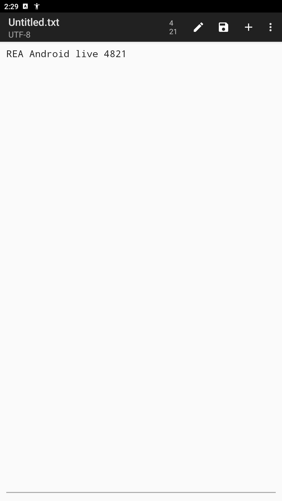

# Editor: agent-generated Android adapter

These files are the unchanged candidate produced by Codex CLI from the Editor 1.98 APK and REA evidence. There was no Editor adapter in the repository before this experiment. The final run used `gpt-6.1-sol / high` for that process only: three read-only REA probes followed by one candidate, which passed all eight live checks. Earlier development failures and a parent-side recovery are recorded separately in the [acceptance record](../../docs/cases/android-generation-acceptance.json).

The module bytes match the original model response. [provenance.json](provenance.json) records the adapter, module, native trace and final-response hashes. The agent inspected only this run's evidence and SDK; it did not read the earlier failed solutions or bundled adapters. The generator does not use this example as a lookup recipe.

## Commands

After [generating the package](../../docs/cases/android-generation.md), apply the environment from its `result.json` and run:

```bash
node .local/generate/editor/package/cli.mjs --schema
node .local/generate/editor/package/cli.mjs buffer read
node .local/generate/editor/package/cli.mjs buffer replace \
  --text "Hello from an agent" --request-id editor-001
```

The compiled package exposes the same commands as `editor-cli`. It needs ADB and the pinned installed APK at runtime; REA, JADX and Codex are generation dependencies, not generated-CLI runtime dependencies. No package has been published to the npm registry as part of this experiment.

## Mapping and limits

REA established the package, native `EditText` binding in `Editor.onCreate`, and the edit-mode transition in `Editor.editClicked`. The generated code identifies controls from each fresh native hierarchy, dismisses the exact observed optional file-access dialog by choosing Cancel, enters edit mode when needed, selects and replaces text through native keyboard input, and restores the prior mode. It does not grant broad file access, call a replacement editor or write application storage directly.

Input is bounded to 8,192 printable ASCII characters and line feeds. The live acceptance covers short test strings and restoration, not every string or the maximum size. Other languages, locales, UI variants and Editor releases have not been accepted; a different APK fails its SHA-256 gate. The native title fields are retained when exposed by the hierarchy; the tested screen did not expose them through the IDs selected by this candidate. This is a current-buffer capability, not a general file-identity or file-management API.

The runtime verifies the observed text and edit/view mode. An independent observer reads `org.billthefarmer.editor:id/text` without importing the adapter and checks both the mutation and restoration. Screenshots support the hierarchy evidence; long text can extend beyond the viewport. The verification level is **native-ui-readback**, not file persistence or backend confirmation.

The repeat scenario after app restart passed 8/8. A deliberately lying no-op copy was caught by the independent observer. A separately installed tarball also read, wrote a second value, passed native observation and restored the original text and mode.


